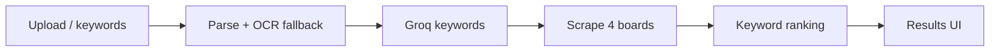

# InternMatch

**AI-powered internship matching** — upload a resume or enter keywords, get ranked internship listings from **LinkedIn**, **Internshala**, **Wellfound**, and **Naukri** in one flow.

Monochrome UI inspired by [WatchDoc](https://github.com/BhuvanGS/WatchDoc), with a pipeline built for job discovery: **OCR → Groq keywords → multi-board scrape → ranked results**.

---

## Features

- **Upload or keywords** — PDF / DOCX / TXT resume, or manual skills + role track
- **Groq extraction** — merges resume keywords with your inputs
- **Fast multi-board search** — HTTP scraper + keyword overlap ranking (`lib/jobScraper.ts`)
- **Ranked results** — best match first, match %, per-source filters, clickable apply links
- **TinyFish** — loading copy presents web discovery as TinyFish agent search (hackathon narrative; **no TinyFish API calls in the backend**)
- **Optional OCR** — Python service for scanned PDFs when text extraction is empty

---


## App routes


| Route              | Purpose                  |
| ------------------ | ------------------------ |
| `/`                | Landing                  |
| `/upload`          | Start a new match        |
| `/results/[jobId]` | Ranked listings + detail |
| `/about`           | Product / how it works   |


There is **no dashboard** or contact page in this build.

---


## How it works

1. **Track + input** — Role fit, optional location, resume and/or keywords
2. **Extract text** — `pdf-parse`, `mammoth`; optional `ocr_api` via `OCR_API_URL`
3. **Keywords** — Groq (`lib/keywordExtractor.ts`, model from `GROQ_MODEL`)
4. **Discover** — Parallel scrape of four boards, merge, score, sort (`lib/jobSearch.ts` → `lib/jobScraper.ts`)
5. **Persist** — Job + results in Supabase; poll `/api/results` from the results page




---


## Architecture


| Layer         | Location                                 |
| ------------- | ---------------------------------------- |
| UI            | `app/` — landing, upload, results, about |
| Analyse API   | `app/api/analyse/route.ts`               |
| Pipeline      | `lib/internMatchProcessor.ts`            |
| Scraping      | `lib/jobScraper.ts`, `lib/jobSearch.ts`  |
| Match scoring | `lib/listingMatchScore.ts`               |
| DB            | `lib/db.ts`, `supabase/schema.sql`       |
| OCR service   | `ocr_api/` (FastAPI)                     |


Processing runs **in-process** when QStash is not configured; otherwise `/api/process` handles the worker.

---


## Environment variables

Copy `.env.example` → `.env.local`:


| Variable                    | Required | Purpose                                                  |
| --------------------------- | -------- | -------------------------------------------------------- |
| `SUPABASE_URL`              | Yes      | Supabase project URL                                     |
| `SUPABASE_SERVICE_ROLE_KEY` | Yes      | Server-side job reads/writes                             |
| `GROQ_API_KEY`              | Yes*     | Resume keyword extraction                                |
| `GROQ_MODEL`                | No       | Default `openai/gpt-oss-20b`                             |
| `NEXT_PUBLIC_APP_URL`       | No       | Base URL for callbacks (default `http://localhost:3000`) |
| `OCR_API_URL`               | No       | e.g. `http://localhost:8000/extract` for scanned PDFs    |
| `QSTASH_*`                  | No       | Async processing in production                           |
| `TINYFISH_API_KEY`          | No       | **Not used by backend** (UI copy only; safe to omit)     |


Without Groq, manual keywords and role track still work.

### Database

Apply schema once (Supabase SQL editor or):

```bash
pnpm db:push
```

Requires `SUPABASE_DB_PASSWORD` in `.env.local` for the apply script, or run `supabase/schema.sql` manually in the dashboard.

---


## Run locally

**Terminal 1 — Next.js**

```bash
pnpm install
pnpm dev
```

**Terminal 2 — OCR (optional, for scanned PDFs)**

```bash
cd ocr_api
python -m venv .venv && source .venv/bin/activate
pip install -r requirements.txt
# Install Tesseract on your OS for OCR
.venv/bin/uvicorn main:app --host 127.0.0.1 --port 8000 --reload
```

Open [http://localhost:3000](http://localhost:3000) → **Get Started** → submit → open the results link.

---


## Tech stack

- **Next.js 16**, React, Tailwind, Motion  
- **Groq** — keyword extraction  
- **Supabase** — jobs storage  
- **FastAPI + Tesseract/PyMuPDF** — OCR microservice  
- **Custom scraper** — Internshala HTML, LinkedIn guest listings, Wellfound, Naukri

---

